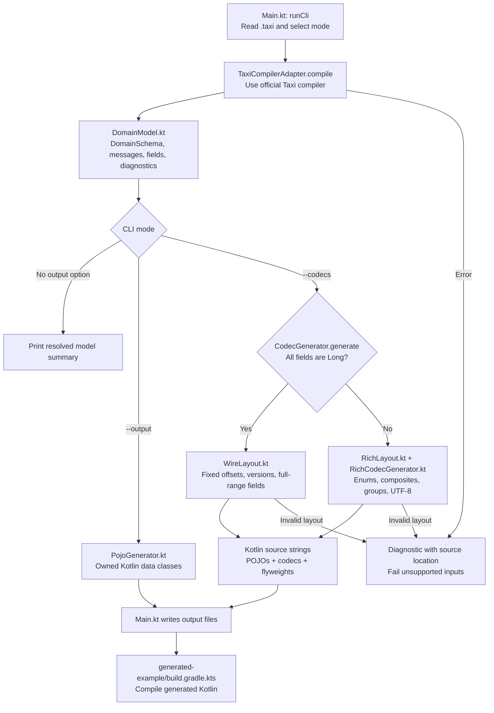
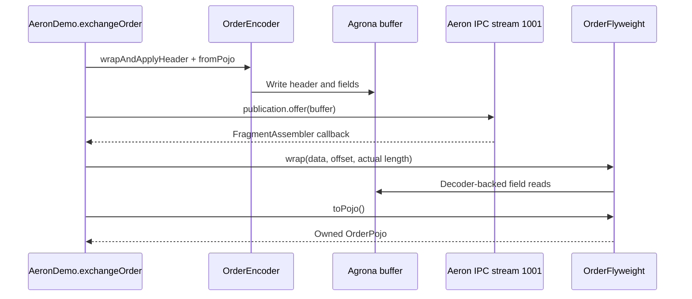

# Taxi generator: code flow

GitHub renders these Mermaid diagrams directly from this Markdown file.

## Compilation and code generation

`--check-compatible` is a separate CLI mode: compile current and baseline schemas,
then let `SchemaCompatibility.kt` compare their validated fixed-field layouts.
It does not write generated output. Existing fields cannot silently move or change
encoding; added fields must be appended, optional, and introduced in a newer version.

## Generated code in use: the IPC demo

The demo owns a temporary embedded driver, has a bounded exchange deadline, and
closes its resources. A borrowed view never escapes the callback; materializing
an owned POJO allocates data. The generator itself runs no cluster or web server.

## File responsibilities and reading order

| File | Job |
| --- | --- |
| [examples/order.taxi](../examples/order.taxi) | Semantic OrderId, Price, Quantity and fixed message metadata. |
| [Main.kt](../src/main/kotlin/com/example/taxicodegen/Main.kt) | CLI modes, reads, diagnostics, writes and exit codes. |
| [TaxiCompilerAdapter.kt](../src/main/kotlin/com/example/taxicodegen/TaxiCompilerAdapter.kt) | Compiler-specific layer; normalize supported Taxi types. |
| [DomainModel.kt](../src/main/kotlin/com/example/taxicodegen/DomainModel.kt) | Compiler-independent domain representation. Semantic Long names currently map to plain Kotlin Long. |
| [WireLayout.kt](../src/main/kotlin/com/example/taxicodegen/WireLayout.kt) | Validate IDs, field ordering, offsets, versioning and required full-range policy. |
| [CodecGenerator.kt](../src/main/kotlin/com/example/taxicodegen/CodecGenerator.kt) | Emit fixed encoders/decoders/flyweights and choose richer profile when needed. |
| [PojoGenerator.kt](../src/main/kotlin/com/example/taxicodegen/PojoGenerator.kt) | Emit owned data classes and enums. |
| [RichLayout.kt](../src/main/kotlin/com/example/taxicodegen/RichLayout.kt) | Plan supported rich record structures. |
| [RichCodecGenerator.kt](../src/main/kotlin/com/example/taxicodegen/RichCodecGenerator.kt) | Emit rich codec source from that plan. |
| [SchemaCompatibility.kt](../src/main/kotlin/com/example/taxicodegen/SchemaCompatibility.kt) | Enforce fixed-profile evolution against preserved schemas. |
| [AeronDemo.kt](../generated-example/src/main/kotlin/com/example/taxicodegen/AeronDemo.kt) | Encode, publish, decode and materialize an Order over actual IPC. |

Generated sources belong under build/; production generation does not invoke the
official SBE compiler. Independent reference codecs are test oracles only.
The counter consumer owns its schema; its build invokes this generator and compiles
the output into counter-protocol. See [wire profile](wire-profile.md) and the
consumer's docs/flow.md for the combined runtime flow.
